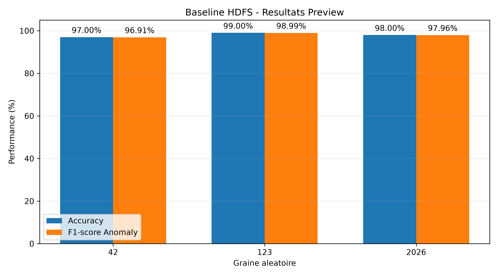

# Apport de la documentation technique à la détection d’anomalies HDFS par un LLM local

**IND-4 · Brouillon de travail, sans résultats expérimentaux.** Ajouter les auteurs et l’affiliation avant la mise en page. Le résumé et la conclusion devront être mis à jour après le test final et la revue humaine.

## Résumé provisoire

Une session Hadoop Distributed File System (HDFS) peut contenir des opérations de réplication, de suppression ou de récupération sans que celles-ci signalent une panne. Une documentation technique peut aider un modèle de langage à interpréter ces événements, mais une justification plausible ne garantit ni une prédiction correcte ni une cause racine démontrée. Cette étude propose de mesurer l’effet de la recherche documentaire sur la détection binaire d’anomalies dans les journaux publics Loghub HDFS v1. Le protocole compare trois méthodes sur les mêmes 100 blocs étiquetés : une régression logistique sur des caractéristiques TF-IDF, un modèle de langage local sans recherche et le même modèle avec récupération de passages issus du guide d’architecture Apache. Les deux variantes du modèle de langage partagent les mêmes paramètres, les mêmes événements et le même format de sortie. L’analyse prévoit des écarts d’exactitude appariés sur trois graines, des mesures de latence et une revue manuelle de la qualité des citations et des affirmations non étayées. Les étiquettes disponibles définissent la portée de l’étude : une détection au niveau du bloc, sans mesure sur capteurs ni validation de la cause racine. Les résultats restent à mesurer.

**Mots-clés :** HDFS, analyse de journaux, détection d’anomalies, génération augmentée par recherche, évaluation appariée.

## 1. Introduction

Les journaux HDFS enregistrent des événements dispersés entre le NameNode et les DataNodes. Parmi ces événements figurent la réception d’un bloc, la gestion de ses répliques ou sa suppression. Certains messages ressemblent à des signaux d’échec lorsqu’ils sont lus isolément alors qu’ils correspondent à un fonctionnement attendu. À l’inverse, une anomalie peut n’apparaître qu’à travers une séquence de messages. Les premières études sur ces journaux ont donc regroupé les lignes par bloc pour apprendre des motifs au niveau de la session [1].

Un classifieur spécialisé peut apprendre ces motifs à partir de sessions annotées, mais il ne produit pas spontanément une justification utilisable par un opérateur. Un LLM peut fournir une explication en langage naturel, au risque de transformer une hypothèse plausible en affirmation. L’accès à une documentation externe peut réduire l’ambiguïté de certaines opérations, mais le passage récupéré peut aussi être hors sujet ou l’explication aller au-delà de ce qu’il permet d’établir.

Nous posons deux questions distinctes. Sur les mêmes blocs HDFS, un LLM local avec recherche documentaire détecte-t-il mieux les anomalies qu’une régression logistique entraînée sur des journaux étiquetés ? La recherche change-t-elle l’exactitude de ce même LLM et le degré de soutien de ses explications ? L’étude sépare ainsi la décision binaire, statistiquement comparable entre méthodes, de la qualité des justifications, évaluée manuellement pour les agents. Le contraste avec le LLM sans recherche isole l’ajout de documentation dans la configuration retenue.

## 2. Travaux connexes

Xu et al. [1] ont montré l’intérêt de structurer les journaux autour des blocs. Loghub [2] rend disponibles des données de référence, tandis que l’évaluation du parsing à grande échelle [4] met en garde contre les conclusions établies sur de petits extraits. D’autres comparaisons soulignent que la version du jeu de données et sa méthode de découpage peuvent modifier les scores et le classement des méthodes [5, 6]. Nous réservons donc des blocs distincts pour la validation, l’aperçu et le test, et ne comparons pas directement nos scores attendus à ceux de travaux utilisant un autre découpage.

Les travaux utilisant des LLM pour les journaux couvrent plusieurs formes de supervision. LogPrompt [7] emploie des stratégies d’instruction, LogLLM [8] entraîne un détecteur à partir de modèles préentraînés et LogRules [9] ajoute des règles explicites. RAPID [10] s’appuie sur la recherche de motifs de journaux. Dans le cadre plus général du RAG, la récupération et la génération peuvent échouer séparément [11–13]. Par conséquent, nous distinguons une référence à un passage réellement fourni d’une référence qui soutient effectivement l’explication.

Les travaux sur le diagnostic opérationnel séparent la détection, la localisation et la recherche de causes [14, 15]. Des études plus proches combinent HDFS et des récits fondés sur des preuves [16], ou récupèrent des incidents historiques étiquetés pour aider un LLM [17]. Notre expérience formule un contraste différent : le RAG consulte uniquement des notices techniques Apache [3] et ne reçoit ni exemple annoté ni historique des incidents. La comparaison porte sur l’effet d’un contexte documentaire pour un modèle local précis [18].

## 3. Matériel et méthodes

### Données et partitions

L’unité d’analyse est la session d’un bloc. Le jeu Loghub HDFS v1 fournit un journal brut et des étiquettes `Normal` ou `Anomaly` par identifiant de bloc [2]. Nous prévoyons un test contenant 50 blocs de chaque classe et un lot d’aperçu équilibré de même taille. Une seule graine fixe ces deux ensembles. Pour chacune des trois graines expérimentales (42, 123 et 2026), les ensembles d’entraînement et de validation sont tirés parmi les blocs restants. L’entraînement comporte 5 000 blocs normaux et 1 000 anomalies ; la validation comporte 1 000 blocs normaux et 250 anomalies.

Nous conservons l’ordre des événements et excluons les lignes mentionnant plusieurs blocs, afin d’éviter qu’une ligne soit partagée entre partitions. Nous masquons les identifiants de bloc, les adresses IP et les nombres, puis conservons jusqu’à douze événements à chaque extrémité de la session. Ce choix borne la taille du contexte tout en préservant le début et la fin d’un traitement. Une session sans observation exploitable reste dans son ensemble d’origine. Nous rapporterons son effectif plutôt que d’écarter ces cas après l’évaluation.

### Méthodes comparées

La baseline associe une représentation TF-IDF de mots et paires de mots à une régression logistique pondérée par classe. Le vocabulaire est appris sur l’entraînement, puis le coefficient de régularisation est choisi d’après le F1 de la classe `Anomaly` sur la validation. Le réglage final est appliqué au test sans second ajustement.

Les deux variantes génératives utilisent le même modèle local Qwen2.5-3B Instruct. Le modèle reçoit les événements numérotés et rend un label, une justification et les références qu’il invoque. Dans le bras RAG, la requête construite à partir de la session sélectionne jusqu’à trois notices techniques par similarité cosinus TF-IDF. Dans le bras sans recherche, la liste des notices est vide. Les sorties malformées ne sont pas regénérées et comptent comme des décisions incorrectes.

### Critères d’évaluation

Nous retenons l’exactitude comme critère principal et rapportons le F1 `Anomaly`, les rappels par classe et les matrices de confusion en complément. Les résultats sont résumés par la moyenne et l’écart-type sur les graines. Pour chaque écart entre méthodes, nous calculons la différence de justesse au niveau du bloc, l’agrégeons sur les graines puis construisons un intervalle à 95 % par bootstrap stratifié sur les blocs. L’unité rééchantillonnée reste le bloc, puisque plusieurs graines produisent des observations corrélées pour un même cas.

La latence de prédiction est mesurée séparément de la préparation des données, de l’entraînement et du chargement initial du modèle ; elle inclut la récupération pour le RAG. Nous enregistrons le nombre de jetons ainsi que le coût direct d’API, qui est nul pour l’inférence locale et ne représente pas le coût matériel ou énergétique. Pour la revue de la graine 42, les réponses des deux agents sont examinées sur tous les blocs, y compris lorsque leur label est correct. Nous relevons les affirmations factuelles non étayées, les citations qui soutiennent une affirmation et la principale catégorie d’erreur pour les décisions incorrectes.

## 4. Résultats à compléter après le test verrouillé

| Méthode | Exactitude, moyenne ± écart-type | F1 Anomaly, moyenne ± écart-type | Sorties invalides | Latence p50/p95 |
|---|---|---|---|---|
| TF-IDF et régression logistique | Non mesuré | Non mesuré | Non mesuré | Non mesuré |
| LLM sans recherche | Non mesuré | Non mesuré | Non mesuré | Non mesuré |
| LLM avec recherche | Non mesuré | Non mesuré | Non mesuré | Non mesuré |

Ajouter les écarts appariés « RAG moins classifieur » et « RAG moins LLM sans recherche » avec leurs intervalles. Présenter ensuite les catégories d’erreurs, les taux de justifications contenant une hallucination et de citations jugées pertinentes, avec les dénominateurs correspondants. Sélectionner des exemples contrastés en exposant le critère de choix, les événements disponibles et ce que les notices attestent effectivement.

### 4.1 Résultats préliminaires de la baseline

La baseline TF-IDF + régression logistique a été évaluée
sur un ensemble preview indépendant de 100 sessions HDFS,
comprenant 50 sessions normales et 50 anomalies.

Les expériences ont été répétées avec trois graines
aléatoires : 42, 123 et 2026.

| Graine | Accuracy | F1 Anomaly |
|--------|----------|------------|
| 42     | 97,00 %  | 96,91 %    |
| 123    | 99,00 %  | 98,99 %    |
| 2026   | 98,00 %  | 97,96 %    |

L'accuracy moyenne atteint 98,00 % avec un écart-type
de 1,00 point. Le F1-score moyen de la classe Anomaly
atteint 97,95 % avec un écart-type de 1,04 point.

Sur les trois exécutions, six faux négatifs ont été
observés, correspondant à quatre sessions distinctes.
L'analyse révèle notamment des avertissements omis
lors de la troncature de certaines longues sessions.

Ces résultats sont exploratoires et ne remplacent pas
l'évaluation finale commune aux trois méthodes.
  

## 5. Discussion et limites prévues

Nous interpréterons séparément la détection et la justification. Un gain sur les citations peut être utile à un opérateur sans améliorer l’exactitude. Un écart compatible avec zéro ne démontre pas l’égalité des méthodes. Enfin, un avantage sur l’échantillon équilibré ne permet pas de prédire directement le nombre de fausses alertes sur un flux réel dont les anomalies sont rares.

Cette évaluation utilise un jeu historique et une seule famille de modèle. Les partitions sont disjointes par bloc, mais des motifs peuvent se répéter entre elles ; la présence d’exemples du jeu public dans le préentraînement du LLM n’est pas vérifiée. Le masquage et la troncature peuvent retirer des indices pertinents. La revue humaine dispose de la provenance des passages et n’est donc pas aveugle à la méthode. Enfin, le jeu de données ne contient ni signaux capteurs appariés ni causes racines annotées. Ces limites excluent une généralisation aux diagnostics de causes ou à d’autres infrastructures.

## 6. Conclusion à rédiger

Après l’exécution, répondre séparément au contraste principal et à l’ablation documentaire. Indiquer ce que la revue ajoute aux scores et dans quel périmètre les conclusions s’appliquent. Ne pas présenter une cause comme vérifiée à partir d’une étiquette binaire.

## Références

La numérotation renvoie aux 18 références de l’[état de l’art](etat_de_l_art.md#références). La liste complète doit être intégrée au document final.
